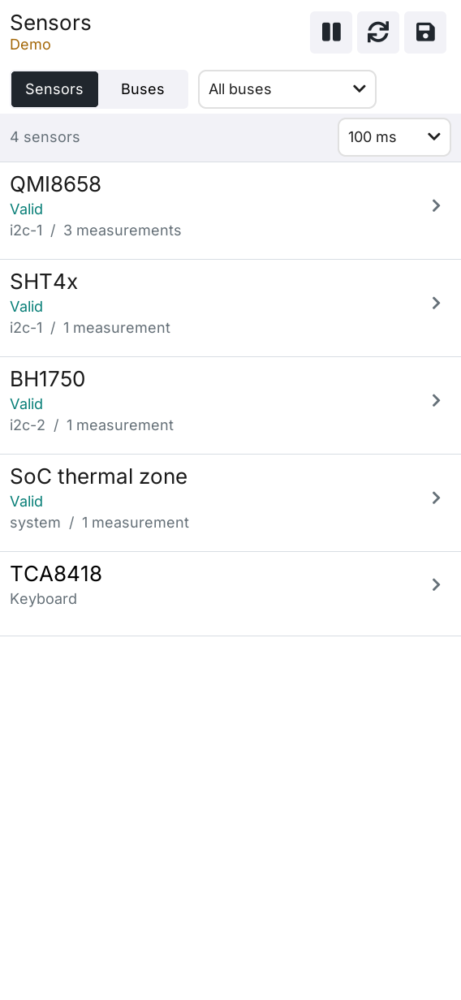
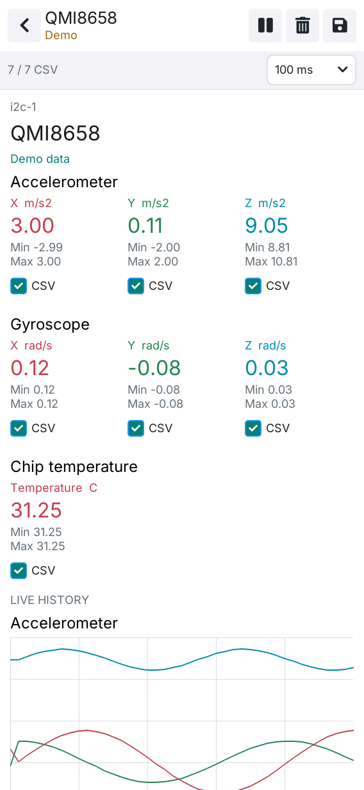
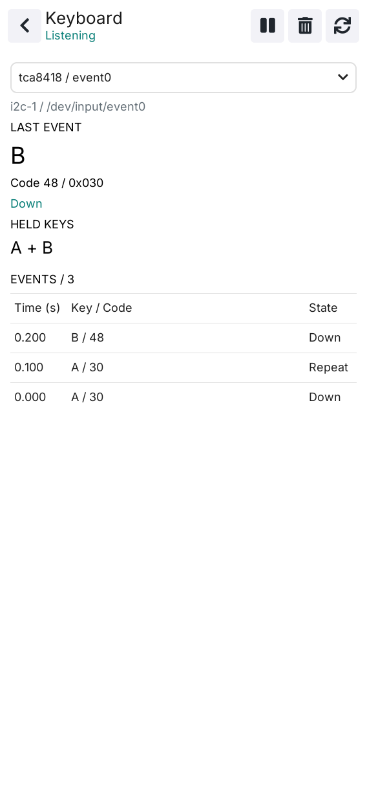

# LILYGO Sensors

[中文 README](README.zh-CN.md)

LILYGO Sensors is a native sensor and input diagnostic tool for T-DisplayCM0.
It uses C++17, LVGL 9.5, and LILYGO UI AppKit, and reads measurements exposed
by the target Linux drivers. The installed application is available from the
LILYGO Launcher as **Sensors**.

## Preview

<p>
  
  
  
</p>

## Features

- Sensor list and per-device detail pages with measurements, history, statistics,
  filtering, pause, clear, and refresh controls.
- IIO and hwmon discovery, including I2C bus inventory and address probing.
- QMI8658 motion data, CPU and battery readings when exposed by the kernel,
  and ES8389 microphone RMS and waveform measurements.
- Per-channel CSV recording with selectable channels and explicit error values.
- TCA8418 keyboard diagnostics with held-key state and recent input history.
- Portrait, landscape, and small-window layouts with background acquisition.
- `--probe` and `--keyboard-probe` NDJSON diagnostics without opening a display.

The UI can run with explicit demo data for screenshots. Demo values are labeled
in the application and are never used as a fallback for real hardware errors.

## Build And Run

Requirements include Python 3.11+, CMake 3.21+, a C++17 compiler, Git, Make,
`pkg-config`, SDL2, FreeType, and LPM. Linux builds also need ALSA development
headers. Initialize the pinned AppKit submodule and install LPM before building:

```sh
git submodule update --init --recursive
python3 -m venv .venv
. .venv/bin/activate
python -m pip install "git+https://github.com/LILYGO-UI/lpm.git"
lpm --version
```

Build and run the desktop simulator with demo data:

```sh
LILYGO_SENSORS_DEMO=1 lpm start --foreground
```

Remove `LILYGO_SENSORS_DEMO=1` to use real host interfaces instead of demo data.
Run the host test suite with:

```sh
lpm test
```

Build the ARM64 Debian package:

```sh
lpm pack
```

Deploy the package using the host, user, and port in `lpm.toml`:

```sh
lpm deploy
```

The detailed dependency, LPM, cross-build, packaging, and troubleshooting steps
are in the [build guide](docs/02-building.md).

## Diagnostics

```sh
lilygo-ui-sensors --probe --samples 3 --interval 250
lilygo-ui-sensors --keyboard-probe --samples 40 --interval 100
```

See [sensor operation and diagnostics](docs/03-sensors-and-diagnostics.md) for
device discovery, recording paths, environment variables, keyboard behavior,
microphone capture, and data interpretation.

## Documentation

| Guide | Contents |
| --- | --- |
| [Build guide](docs/02-building.md) | Dependencies, host simulator, tests, cross compilation, packaging, and troubleshooting |
| [Sensor operation and diagnostics](docs/03-sensors-and-diagnostics.md) | Hardware data sources, probes, CSV recording, keyboard, microphone, and environment variables |
| [Architecture overview](docs/00-overview.md) | Module boundaries, build contract, and project structure |
| [UI development guidelines](docs/01-user-interface.md) | Layout, typography, ownership, and UI validation requirements |

## License And Platform

The application ID is `cc.lilygo.ui.Sensors`; the package and executable name
is `lilygo-ui-sensors`. AppKit supplies the shared runtime fonts and their
license notices. See [LICENSE](LICENSE) for the project license.
