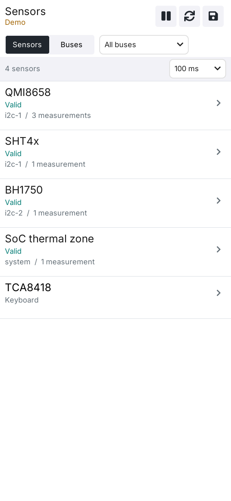
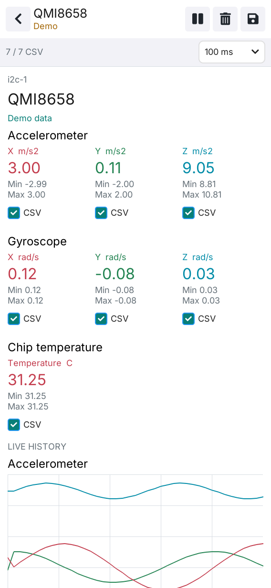
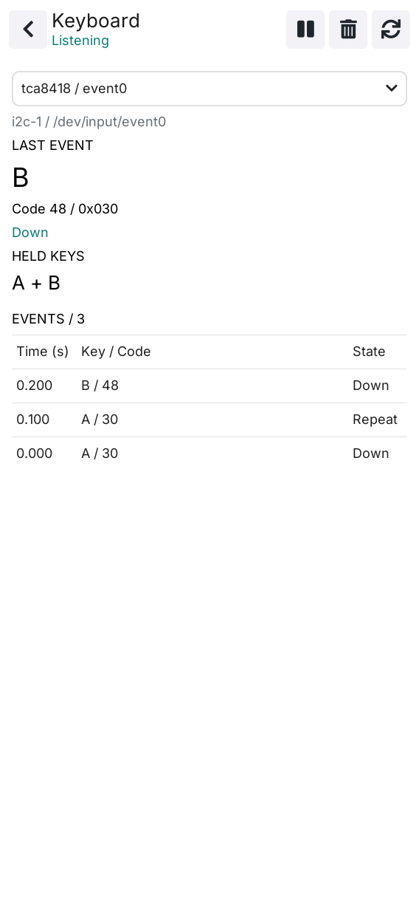

# LILYGO Sensors

[English README](README.md)

LILYGO Sensors 是面向 T-DisplayCM0 和 T-Display-K230 的原生传感器和输入诊断工具，使用 C++17、
LVGL 9.5 与 LILYGO UI AppKit，读取目标板 Linux 驱动提供的测量数据。安装后可从
LILYGO Launcher 的 **Sensors** 图标打开。

## 预览

<p>
  
  
  
</p>

## 功能

- 传感器列表和单器件详情页，支持读数、历史曲线、统计、筛选、暂停、清除和刷新。
- IIO、hwmon 动态发现，以及 I2C 总线清单和地址探测。
- T-Display-K230 的板载 AHT20 提供环境温度和相对湿度。优先读取 hwmon，驱动未绑定时通过 I²C 采样。
- K230 的 **BQ25896** 详情页显示 USB 输入电压、实测充电电流、充电状态，以及电源服务发布的电流限制和充电设定值。
- K230 的 **BQ27220** 电量计显示电量百分比、电池电压、电流、温度、剩余容量、满充容量、设计容量和循环次数。有时间估算时，还会显示预计充满或放空所需的分钟数。
- QMI8658 运动数据和内核提供的 CPU/电池数据。
- 麦克风 RMS 电平与波形：K230 通过片内 INNO 编解码器采集直连的歌尔 B4012AP422-003，CM0 通过 ES8389 采集。
- 可按通道选择的 CSV 记录，并明确记录读取错误。
- TCA8418 键盘诊断，显示当前按键和最近输入历史。
- 支持竖屏、横屏和小窗口，采集工作在后台线程执行。
- `--probe` 和 `--keyboard-probe` 命令行 NDJSON 诊断，无需打开显示器。

界面支持显式演示数据用于截图。演示数据会在界面中标明，不会替代真实硬件错误。

## 构建和运行

需要 Python 3.11+、CMake 3.21+、C++17 编译器、Git、Make、`pkg-config`、SDL2、
FreeType 和 LPM。Linux 麦克风支持还需要 ALSA 开发头文件。首次构建前初始化
AppKit 子模块并安装 LPM：

```sh
git submodule update --init --recursive
python3 -m venv .venv
. .venv/bin/activate
python -m pip install "git+https://github.com/LILYGO-UI/lpm.git"
lpm --version
```

使用 LPM 构建并运行桌面模拟器：

```sh
LILYGO_SENSORS_DEMO=1 lpm start --foreground
```

移除 `LILYGO_SENSORS_DEMO=1` 可读取主机真实接口。运行主机测试：

```sh
lpm test
```

构建 ARM64 Debian 安装包：

```sh
lpm pack
```

使用 `lpm.toml` 中的主机、用户和端口部署安装包：

```sh
lpm deploy
```

完整依赖、LPM、交叉构建、打包和排错步骤见[构建与测试](docs/02-building.md)。

## 诊断

```sh
lilygo-ui-sensors --probe --samples 3 --interval 250
lilygo-ui-sensors --keyboard-probe --samples 40 --interval 100
```

设备发现、记录路径、环境变量、键盘行为、麦克风采集和数据解释见
[传感器与诊断](docs/03-sensors-and-diagnostics.md)。

## 文档

| 文档 | 内容 |
| --- | --- |
| [构建与测试](docs/02-building.md) | 依赖、主机模拟器、测试、交叉编译、打包和排错 |
| [传感器与诊断](docs/03-sensors-and-diagnostics.md) | 硬件数据源、诊断命令、CSV、键盘、麦克风和环境变量 |
| [架构总览](docs/00-overview.md) | 模块边界、构建约定和项目结构 |
| [UI 开发规范](docs/01-user-interface.md) | 布局、字体、所有权和 UI 验收要求 |

## 许可和平台

应用 ID 为 `cc.lilygo.ui.Sensors`，软件包和可执行文件名为 `lilygo-ui-sensors`。
AppKit 提供运行时共享字体及其许可证声明。项目许可证见 [LICENSE](LICENSE)。

## K230 Debian riscv64 打包

`k230-debian` preset 用于 T-Display-K230 的 Debian riscv64 应用构建。
需要支持架构选择的 LPM，以及包含 `cmake/k230-debian-toolchain.cmake` 的
AppKit 源码 SDK。原有 CM0 ARM64 和桌面模拟器 preset 仍可使用。

Linux 主机安装 `gcc-riscv64-linux-gnu` 和 `g++-riscv64-linux-gnu`，macOS 主机用 `brew install llvm lld dpkg` 安装交叉编译和打包工具。在应用仓库根目录运行打包命令。

```sh
lpm pack --arch riscv64
```

`k230-debian` CMake 预设首次配置时从 `LILYGO-UI/canaan-gen` Release 下载固定版本的 Debian BSP，校验 SHA-256，并将压缩包和 `sysroot/` 保存在当前项目的 `.cache/k230-bsp/20261116T104343Z/`。之后可以离线打包，重新生成 `build/` 也会复用缓存。生成的 `.deb` 在 `dist/` 目录。

执行一次 `lpm set-target k230` 后，后续直接运行 `lpm pack`。如需自定义 Debian sysroot，在首次配置前设置 `LILYGO_UI_DEBIAN_SYSROOT`，或向 CMake 传入 `-DLILYGO_UI_DEBIAN_SYSROOT=/path/to/sysroot`。AppKit 默认使用 `third_party/cm0-appkit`，可用 `-DLilyGoUI_DIR=/path/to/appkit` 指定其他版本。

执行 `lpm set-target k230` 可将 K230 保存为默认打包目标，此后直接运行
`lpm pack` 即会选择 riscv64。

设备构建需要 riscv64 的 ALSA 开发文件以支持麦克风采集；共享 SDK 的 sysroot
准备脚本会准备该依赖。
