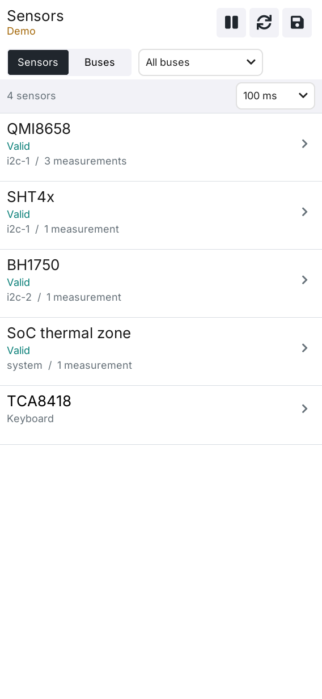
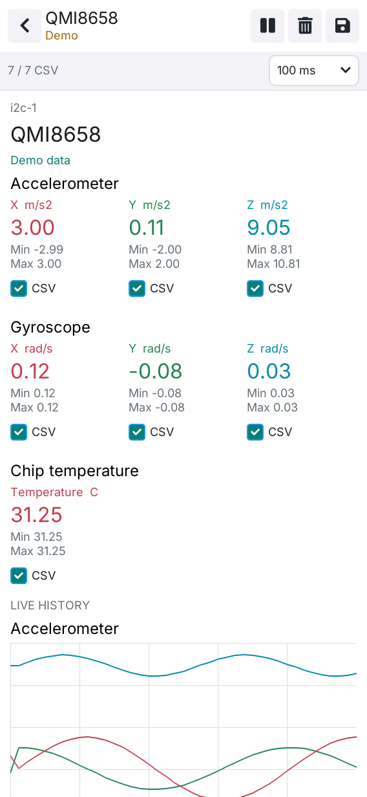
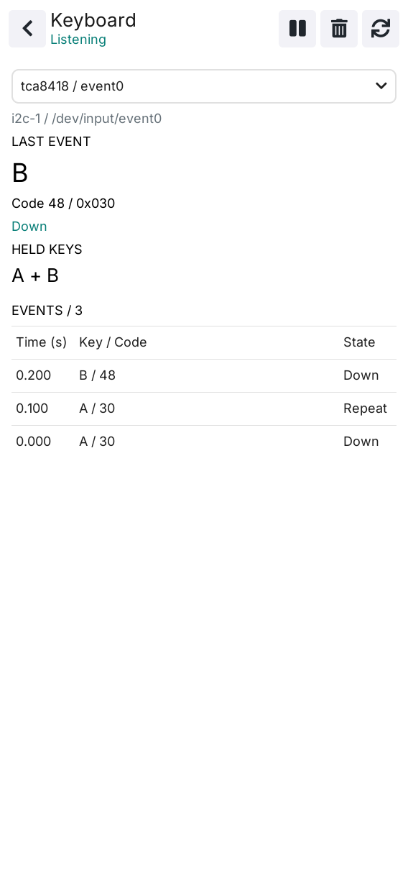

# LILYGO Sensors

[English README](README.md)

LILYGO Sensors 是面向 T-DisplayCM0 的原生传感器和输入诊断工具，使用 C++17、
LVGL 9.5 与 LILYGO UI AppKit，读取目标板 Linux 驱动提供的测量数据。安装后可从
LILYGO Launcher 的 **Sensors** 图标打开。

## 预览

<p>
  
  
  
</p>

## 功能

- 传感器列表和单器件详情页，支持读数、历史曲线、统计、筛选、暂停、清除和刷新。
- IIO、hwmon 动态发现，以及 I2C 总线清单和地址探测。
- QMI8658 运动数据、内核提供的 CPU/电池数据，以及 ES8389 麦克风 RMS 和波形。
- 可按通道选择的 CSV 记录，并明确记录读取错误。
- TCA8418 键盘诊断，显示当前按键和最近输入历史。
- 支持竖屏、横屏和小窗口，采集工作在后台线程执行。
- `--probe` 和 `--keyboard-probe` 命令行 NDJSON 诊断，无需打开显示器。

界面支持显式演示数据用于截图。演示数据会在界面中标明，不会替代真实硬件错误。

## 构建和运行

需要 CMake 3.21+、C++17 编译器、Git、Make、LPM、`pkg-config`、SDL2 和 FreeType。
Linux 麦克风支持还需要 ALSA 开发头文件。首次配置前初始化 AppKit 子模块：

```sh
git submodule update --init --recursive
cmake --preset host-simulator
cmake --build --preset host-simulator --parallel
ctest --preset host-simulator
```

使用演示数据运行桌面模拟器：

```sh
LILYGO_SENSORS_DEMO=1 ./build/host-simulator/lilygo-ui-sensors
```

构建 ARM64 Debian 安装包：

```sh
cmake --preset cm0-cross
cmake --build --preset cm0-cross --parallel
cpack --config build/cm0-cross/CPackConfig.cmake -B dist
```

完整依赖、交叉构建、打包和排错步骤见[构建与测试](docs/02-building.md)。

## 诊断

```sh
lilygo-ui-sensors --probe --samples 3 --interval 250
lilygo-ui-sensors --keyboard-probe --samples 40 --interval 100
```

设备发现、记录路径、环境变量、键盘行为、麦克风采集和数据解释见
[传感器与诊断](docs/03-sensors-and-diagnostics.md)。

## 文档

| 文档 | 内容 |
| --- | --- |
| [构建与测试](docs/02-building.md) | 依赖、主机模拟器、测试、交叉编译、打包和排错 |
| [传感器与诊断](docs/03-sensors-and-diagnostics.md) | 硬件数据源、诊断命令、CSV、键盘、麦克风和环境变量 |
| [架构总览](docs/00-overview.md) | 模块边界、构建约定和项目结构 |
| [UI 开发规范](docs/01-user-interface.md) | 布局、字体、所有权和 UI 验收要求 |

## 许可和平台

应用 ID 为 `cc.lilygo.ui.Sensors`，软件包和可执行文件名为 `lilygo-ui-sensors`。
AppKit 提供运行时共享字体及其许可证声明。项目许可证见 [LICENSE](LICENSE)。
